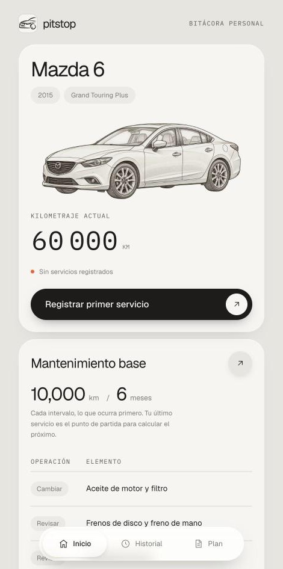
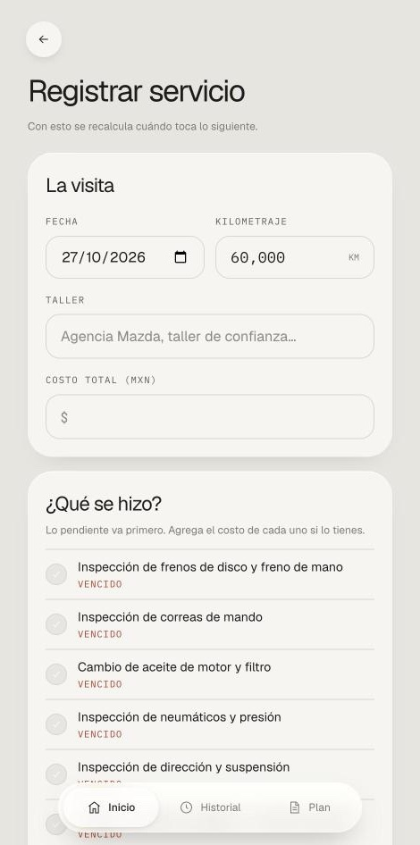
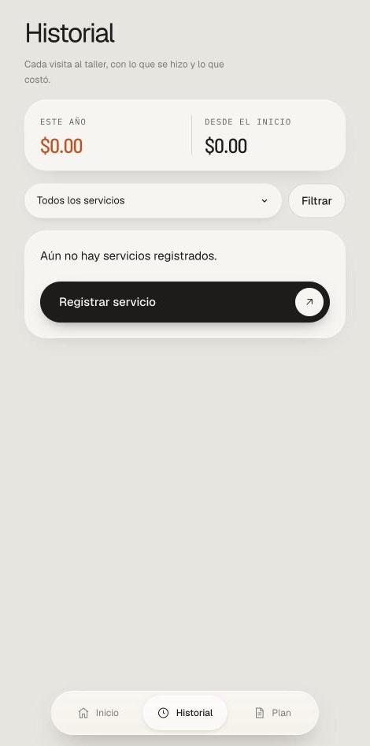
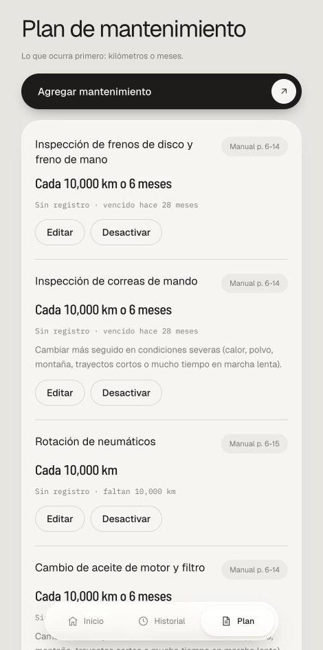
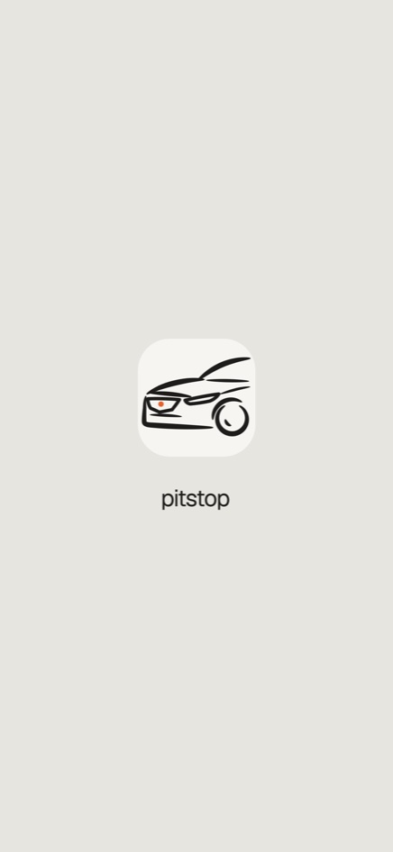

<p align="center">
  
</p>

<h1 align="center">Pitstop</h1>

<p align="center">
  Bitácora personal de mantenimiento para mi Mazda 6 2015:<br />
  qué toca, qué ya se hizo y cuánto ha costado.
</p>

---

## What it is

Pitstop is a small, single-user web app that keeps the maintenance log of one car. It follows the
intervals from the owner's manual (every 10,000 km or 6 months, whichever comes first), and
answers the one question that matters when you open it: **what's due at the next visit?**

- **Inicio** — the car, its current odometer and the next service, grouped by what's overdue or coming up.
  Tap the odometer to update the kilometres.
- **Registrar servicio** — log a visit: date, km, workshop, cost, what was done (with per-item cost),
  notes and receipts (PDF or photos). Due dates are recalculated from it.
- **Historial** — every visit grouped by year, with spend this year and since the start, filterable by item.
- **Plan** — the maintenance plan from the manual (with page references), editable, plus your own items.

It's in Spanish, formatted for Mexico (MXN, es-MX dates), installable on the phone's home screen, and
designed to run for **$0** (Vercel Hobby + Supabase Free).

## Screenshots

| Inicio | Registrar servicio | Historial | Plan |
| :---: | :---: | :---: | :---: |
|  |  |  |  |

<p align="center">
  <br />
  <sub>Splash screen when launched from the home screen.</sub>
</p>

## Stack

- [Next.js 16](https://nextjs.org) (App Router, Cache Components) + React 19
- [Tailwind CSS 4](https://tailwindcss.com), with a small UI kit in `components/ui`
- [Supabase](https://supabase.com) for auth, Postgres (with row-level security) and receipt storage
- [Vitest](https://vitest.dev) for unit tests, pgTAP for database policy tests

## Running it locally

Requires Node 20+, [pnpm](https://pnpm.io) and Docker (for the local Supabase stack).

```bash
pnpm install
pnpm supabase start          # ports 5532x; applies migrations and supabase/seed.sql
cp .env.example .env.local   # fill with the local URL (http://127.0.0.1:55321) and anon key from `pnpm supabase status`
pnpm dev                     # http://localhost:3000
```

Local login: `dev@pitstop.local` / `pitstop-dev` (created by `supabase/seed.sql`, local only).

| Command | What it does |
| --- | --- |
| `pnpm dev` | Start the dev server |
| `pnpm build` / `pnpm start` | Production build and server |
| `pnpm test` | Unit tests (Vitest) |
| `pnpm supabase test db` | Row-level security tests (pgTAP) |
| `pnpm lint` | ESLint |
| `pnpm icons` | Regenerate every app icon and iOS splash screen from the mark in `scripts/build-icons.mjs` |

## Production setup (one time)

1. **Supabase:** create a free project. Link it with `pnpm supabase link --project-ref <ref>` and run `pnpm supabase db push`.
2. **Auth:** under Authentication → Sign In / Providers, turn off "Allow new users to sign up". Create your user under Authentication → Users.
3. **Seed your car:** in the SQL editor, run
   `select seed_pitstop('<your user id>', <current km>, '<YYYY-MM-DD purchase or start date>');`
   Past services can then be added from the app; old dates and lower km are accepted.
4. **Vercel:** import the GitHub repo and set these environment variables:
   - `NEXT_PUBLIC_SUPABASE_URL`
   - `NEXT_PUBLIC_SUPABASE_ANON_KEY`
   - `CRON_SECRET` (any long random string)

   Then deploy. `vercel.json` schedules a twice-weekly keep-alive to `/api/cron/keepalive`, so the free database doesn't pause.

## Free-tier limits worth knowing

- Supabase Storage: 1 GB in total for receipts. Each file is limited to 10 MB.
- Supabase pauses a free project after 7 idle days. The twice-weekly cron prevents this.

## Project layout

```
app/              routes: (app)/ for signed-in screens, login/, manifest, icons
components/ui/    the UI kit — Panel, Chip, Label, Orb, PillAction, PageHeader, Field, …
lib/              due-date logic, formatting, data access, Supabase clients
scripts/          build-icons.mjs — icon and splash generator
supabase/         migrations, seed and database tests
docs/             design spec and screenshots
```

Design spec: `docs/superpowers/specs/2026-10-26-pitstop-design.md`
